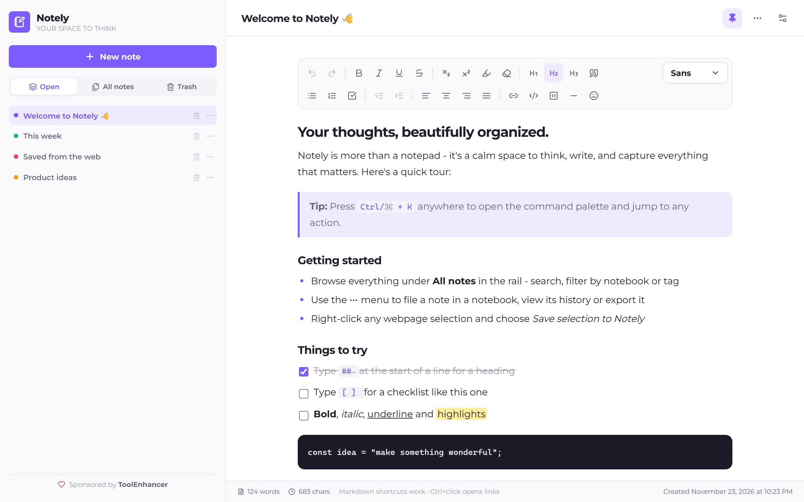
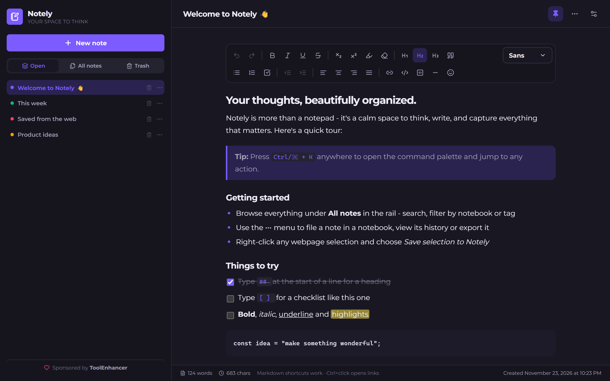
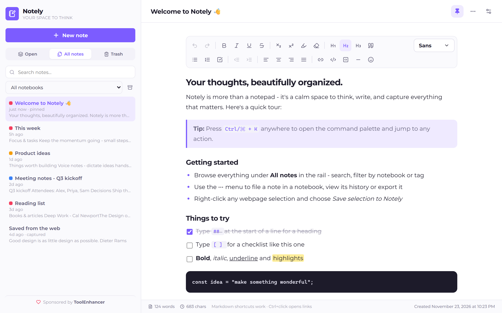
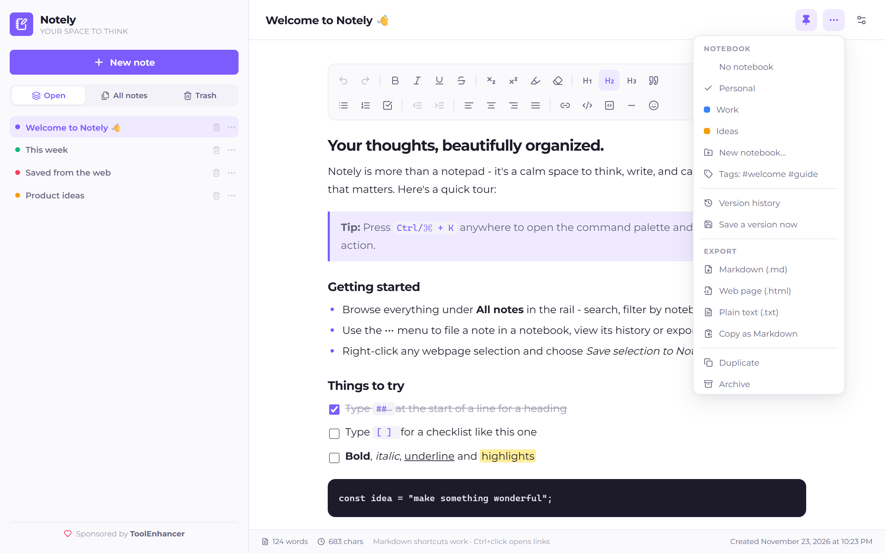
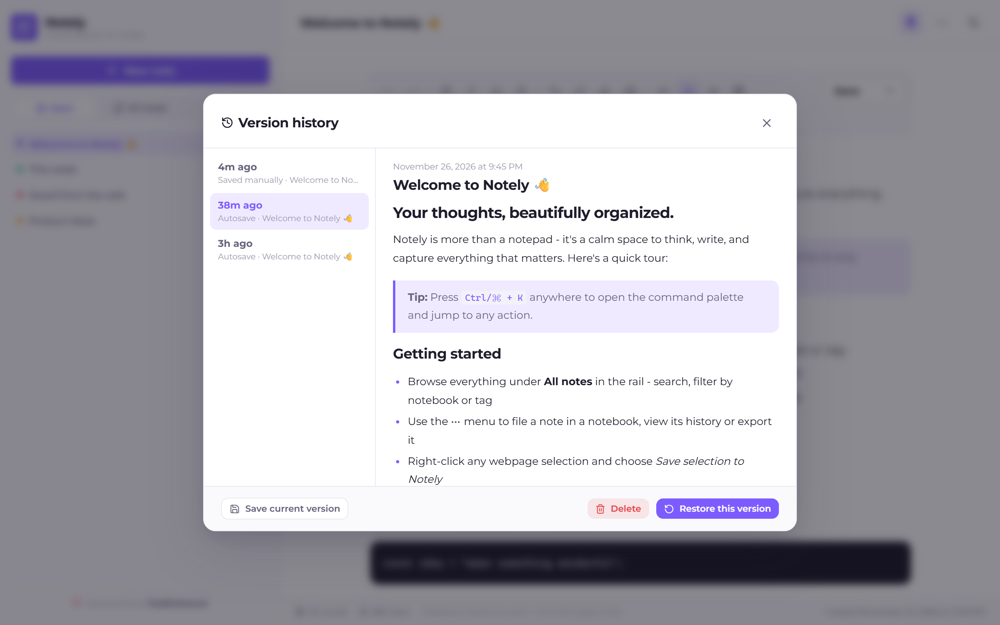
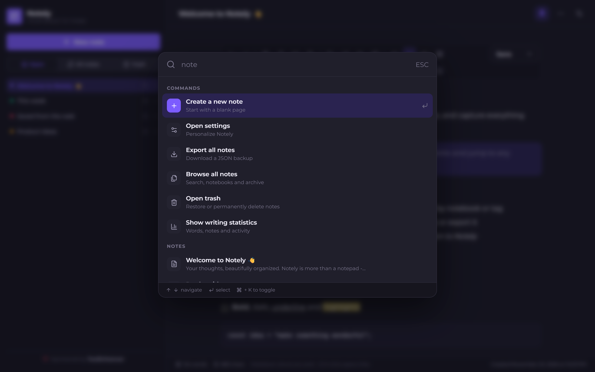
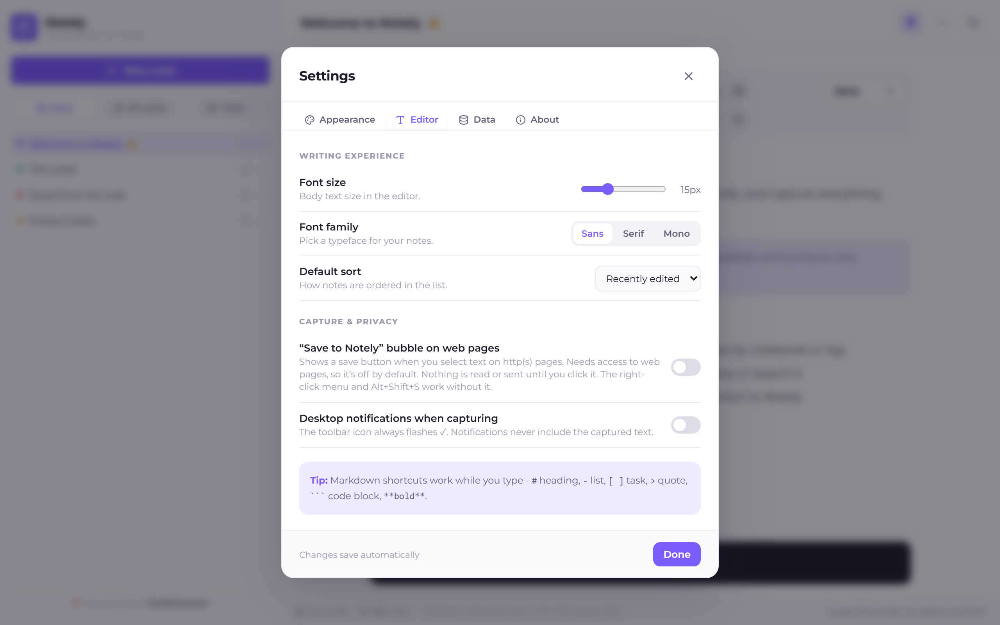
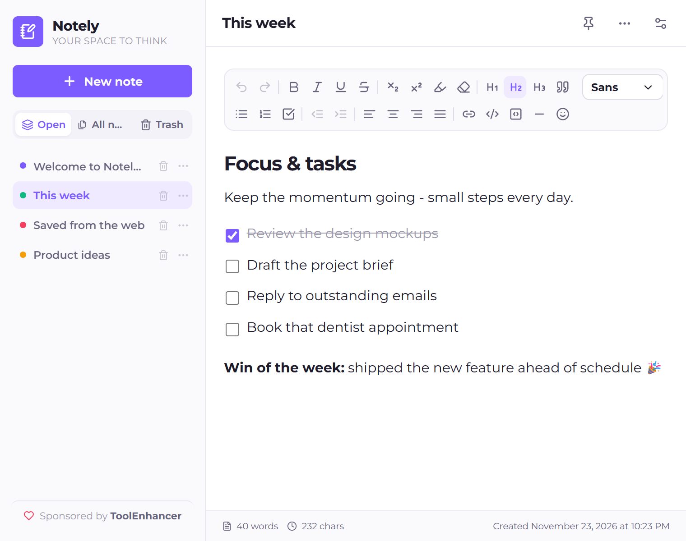

<div align="center">


# Notely - Advanced Notepad

**A fast, private, rich-text notepad that lives in your browser.**
Write in the popup, the side panel or a full tab, capture anything from the web, and keep it all on your device.


[GitHub](https://github.com/Toolvanta/notely) · [Portfolio](https://shoaibarif.vercel.app/) · [LinkedIn](https://www.linkedin.com/in/shoaibmarif/) · [Sponsor](http://toolenhancer.com/)



</div>

---

## Contents

- [Why Notely](#why-notely)
- [Screenshots](#screenshots)
- [Features](#features)
- [Keyboard shortcuts](#keyboard-shortcuts)
- [Install](#install)
- [Development](#development)
- [Publishing to the Chrome Web Store](#publishing-to-the-chrome-web-store)
- [Privacy & permissions](#privacy--permissions)
- [Project structure](#project-structure)
- [How it works](#how-it-works)
- [Contributing](#contributing)
- [Author & support](#author--support)

## Why Notely

- **Always one click away.** The same notes open from the toolbar popup, Chrome's side panel or a full tab, and edits sync between them instantly.
- **A real editor.** Tiptap/ProseMirror with Markdown shortcuts, task lists, reliable undo and clean pasting. No `contentEditable` hacks.
- **Capture the web.** Save a selection, a page or a link from the right-click menu or a keyboard shortcut.
- **Private by design.** No accounts, no servers, no analytics. Notes never leave your browser, and the extension asks for no site access unless you opt in.

## Screenshots

| Light | Dark |
| --- | --- |
|  |  |

| All notes: search and filter | Note menu: notebook, history, export |
| --- | --- |
|  |  |

| Version history | Command palette (`Ctrl/⌘ + K`) |
| --- | --- |
|  |  |

| Capture & privacy settings | Toolbar popup (760 × 600) |
| --- | --- |
|  |  |

## Features

### ✍️ Writing
- Rich-text editor built on **Tiptap / ProseMirror** with a two-row toolbar: undo/redo, bold, italic, underline, strikethrough, sub/superscript, multi-colour highlight, clear formatting, H1–H3, quote, bullet / numbered / **task lists**, indent/outdent, alignment, links, inline code, code blocks, dividers and emoji.
- **Markdown shortcuts while you type:** `# ` heading · `- ` list · `1. ` numbered list · `[ ] ` task · `> ` quote · ` ``` ` code block · `**bold**` · `*italic*` · `---` divider.
- Per-note **undo/redo** that never leaks between notes.
- **Clean pasting:** scripts, styles, images and unknown markup are stripped.
- Nested checklists with `Tab` / `Shift+Tab`.
- Sans, Serif and Mono typefaces with adjustable size, plus live word and character counts.

### 🗂️ Organising
- The rail has three views: **Open** (your tabs), **All notes** (search, filter by notebook or tag, show archived) and **Trash** (restore, delete forever, empty).
- **Notebooks, tags, pinning and archiving** from each note's **⋯** menu.
- **Version history:** automatic snapshots every couple of minutes plus manual ones; preview, restore or delete them.
- Nothing is lost by accident. Deleting moves a note to the trash with an **Undo** toast, and permanent deletion always asks first.

### 🌐 Capturing
- Right-click → **Save selection**, **Save page** or **Save link** to Notely.
- `Alt+Shift+S` saves the current selection, and `Alt+Shift+Q` starts a quick note in the side panel.
- Captured notes open as a tab automatically, keep their source link and are tagged `capture`.
- Optional **"Save to Notely" bubble** that appears when you select text. It's off by default, and can be hidden per site.

### 📤 Exporting
- Export a note as **Markdown**, a **standalone HTML page** or **plain text**, or copy it as Markdown.
- Full **JSON backup and restore** (merge or replace) from Settings or the command palette.

### 🎨 Look & feel
- Light, dark and system themes with six accent colours.
- Command palette (`Ctrl/⌘ + K`) for every action and note.
- Montserrat bundled locally, so the app makes no font requests.

## Keyboard shortcuts

| Action | Shortcut |
| --- | --- |
| Open the popup | `Alt + Shift + N` |
| Quick note (side panel) | `Alt + Shift + Q` |
| Save selected text | `Alt + Shift + S` |
| Open the side panel | `Alt + Shift + O` |
| New note | `Ctrl/⌘ + N` |
| Command palette | `Ctrl/⌘ + K` |
| Bold / italic / underline | `Ctrl/⌘ + B / I / U` |
| Undo / redo | `Ctrl/⌘ + Z` / `Ctrl/⌘ + Shift + Z` |
| Indent / outdent a list item | `Tab` / `Shift + Tab` |
| Open a link inside a note | `Ctrl/⌘ + click` |
| Close the current note | `Esc` (when not typing) |
| Close a tab in the rail | Middle-click, or ⋯ → Close tab |

Browser-level shortcuts can be changed at `chrome://extensions/shortcuts`.

## Install

### From the Chrome Web Store
*Coming soon.* The link will appear here once the listing is published.

### From source (developer mode)
Requires **Node.js 20+** and **Chrome 116+**.

```bash
git clone https://github.com/Toolvanta/notely.git
cd notely
npm install
npm run build
```

1. Open `chrome://extensions`.
2. Turn on **Developer mode** (top right).
3. Click **Load unpacked** and choose the `dist` folder.
4. Pin Notely from the puzzle-piece menu and press `Alt+Shift+N`.

## Development

```bash
npm run dev        # Vite dev server: open http://localhost:5173/options.html
npm run typecheck  # TypeScript project check
npm run build      # icons + typecheck + production build into dist/
npm run package    # build, then zip dist/ into release/notely-<version>.zip
```

In a normal browser tab (`npm run dev`) there is no `chrome.*` API, so storage falls back to `localStorage`. That's handy for UI work, but test capture, the side panel and permissions by loading `dist` as an unpacked extension. After changing code, run `npm run build` and press the **reload** icon on Notely's card in `chrome://extensions`.

## Publishing to the Chrome Web Store

The full step-by-step guide, including the store listing text, permission justifications and privacy answers, is in **[docs/PUBLISHING.md](docs/PUBLISHING.md)**. In short:

1. Bump `version` in `public/manifest.json` and `package.json`.
2. Run `npm run package` to create `release/notely-<version>.zip`.
3. Upload the zip in the [Chrome Web Store Developer Dashboard](https://chrome.google.com/webstore/devconsole), fill in the listing and privacy tabs, and submit for review.

## Privacy & permissions

Notely stores everything in `chrome.storage.local` on your device. It has **no servers, accounts, analytics or remote code**. See the full [privacy policy](PRIVACY.md).

| Permission | Why it's needed |
| --- | --- |
| `storage`, `unlimitedStorage` | Save notes, notebooks, settings and version history locally |
| `sidePanel` | Show Notely in Chrome's side panel |
| `contextMenus` | "Save selection / page / link to Notely" in the right-click menu |
| `activeTab`, `scripting` | Read the selected text **only** on the tab where you press the shortcut |
| *Optional:* http(s) site access | Only if you turn on the selection bubble; removed when you turn it off |
| *Optional:* `notifications` | Only if you turn on capture notifications; they never include the captured text |

Security details:
- **Note HTML is sanitized** with DOMPurify, using an allow-list: http(s)/mailto links only, and no scripts, forms, images or `url()` styles. This applies on paste, import, preview and export.
- **A strict Content Security Policy** (`script-src 'self'; object-src 'none'; img-src 'self' data:` …) blocks remote resources.
- **Pages can't touch the selection bubble.** It uses a closed shadow root and ignores synthetic clicks, so pages can't read it or trigger saves. Page titles and URLs come from Chrome, not from the page.

## Project structure

```
public/
  manifest.json        Extension manifest (MV3)
  content.js           Optional selection bubble (registered at runtime when enabled)
  icons/, fonts/       Generated icons and bundled Montserrat
src/
  background.ts        Service worker: context menus, commands, capture, bubble registration
  App.tsx, main.tsx    App shell for the popup, side panel and full tab
  components/          Rail (tabs / library / trash), Tiptap editor, note menu, version history,
                       command palette, settings (incl. capture & privacy), stats, toast
  lib/                 Storage keys + per-note storage, shared types/defaults, DOMPurify sanitizer,
                       Markdown export, backups, links, sample notes
  store/               App state with cross-view sync
  styles/              Design tokens and component styles
scripts/
  generate-icons.mjs   Builds the PNG icons
  package.mjs          Zips dist/ for the Web Store
docs/
  screenshots/         README images
  PUBLISHING.md        Chrome Web Store guide
popup.html · sidepanel.html · options.html   Entry points
```

## How it works

- **One key per note.** Notes are stored under `notely:note:<id>`, so the popup, side panel, full tab and background can't overwrite each other's work. Each view writes only the notes that changed, and merges updates from other views by edit time.
- **No lost keystrokes.** Changes are flushed when a view is hidden or closed, which matters for the popup because it closes the moment you click away.
- **Shared code.** The service worker is bundled as an ES module from `src/background.ts` and shares its types, defaults and storage keys with the UI.
- **Migration.** Data from 1.0 (a single notes array and the old checklist markup) is upgraded automatically on first launch.

## Contributing

Issues and pull requests are welcome at **[github.com/Toolvanta/notely](https://github.com/Toolvanta/notely)**.

1. Fork the repo and create a branch: `git checkout -b feature/my-idea`.
2. Run `npm run typecheck && npm run build` before opening a PR.
3. Describe what changed and how you tested it (ideally with the extension loaded unpacked).

## Author & support

Built by **Shoaib Arif**.

- **Source code:** [github.com/Toolvanta/notely](https://github.com/Toolvanta/notely)
- **Portfolio:** [shoaibarif.vercel.app](https://shoaibarif.vercel.app/)
- **LinkedIn:** [in/shoaibmarif](https://www.linkedin.com/in/shoaibmarif/)
- **Sponsor:** [toolenhancer.com](http://toolenhancer.com/)

If Notely helps you, a ⭐ on GitHub or a sponsorship keeps it going.
